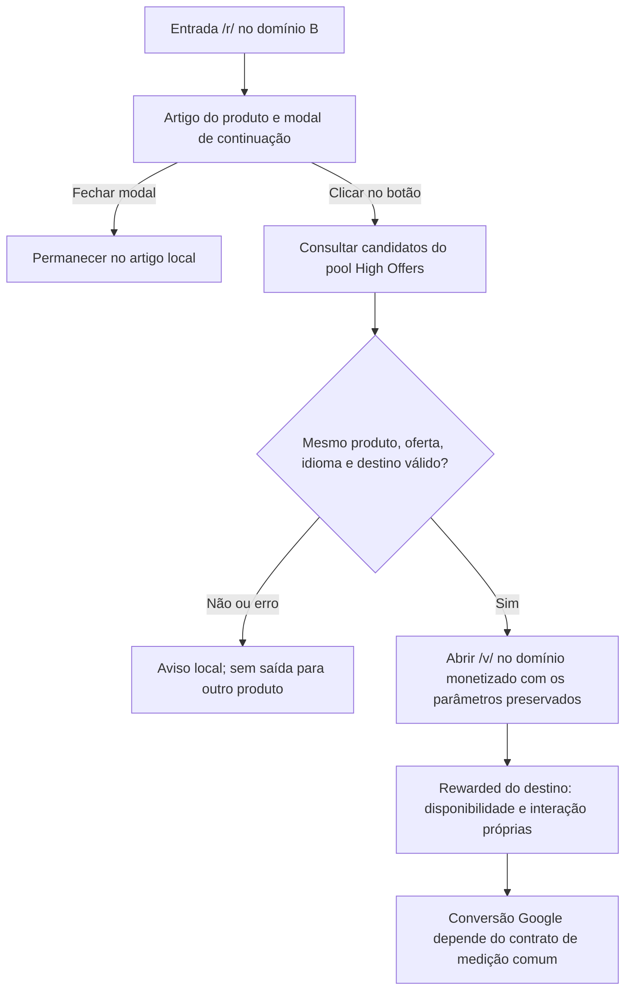

# Test-b — modal de continuação e saída para o /v/

Atualizado em 21/10/2026. Escopo: desenho e tarefas. Não implementar nem publicar nesta etapa.

**Contrato confirmado pelo usuário:** o test-b abre a modal de “rewarded”. O clique no botão leva ao `/v/` do mesmo produto no site monetizado. A entrada do B não faz a saída automática proposta para o A.

O nome “rewarded” descreve a modal de continuação. O B não precisa exibir um anúncio nem aguardar recompensa antes dessa saída. O anúncio rewarded existente continua no destino `/v/`. A interface deve informar a continuação para outro site; não afirmar que uma recompensa foi concedida no B.

## Ponto de partida

- [x] Projeto B com stream próprio e fingerprint habilitado.
- [x] Código atual identificado: o B ainda usa `../arb-test-base/`.
- [x] Confirmado o gatilho desejado de navegação: clique no botão da modal.
- [x] Reutilizar os [12 artigos e slugs selecionados](../arb-test-a/LANCAMENTO.md#slugs-selecionadas-para-o-próximo-teste), todos existentes no pool: quatro em `pt`, quatro em `en` e quatro em `es`.
- [ ] Definir domínio e identidade do B; `site-b.example` continua sendo placeholder.

O B ainda não foi publicado. A modal descrita aqui ainda não existe na implementação atual. A classificação Adspect não muda conteúdo ou destino no código atual.

## Desenho planejado

| Variante planejada | Gatilho de saída | Rewarded antes da saída |
| --- | --- | --- |
| A / CheersToSochi | Proposta de saída automática no servidor, ainda dependente do contrato de entrada e URL anunciada. O A publicado hoje usa botão. | Não integra o desenho solicitado. |
| B | Clique explícito no botão da modal. Abrir, fechar ou esperar não abre o parceiro. | A modal não comprova exibição de anúncio ou recompensa; o rewarded real está no `/v/`. |

Conteúdo, produto e possibilidade de continuação devem permanecer consistentes para visitantes e revisores. Fechar a modal mantém a leitura local.

## 1. Fechar identidade e interface

- [ ] B01. Definir o domínio real do B.
- [ ] B02. Definir nome, identidade e template a reutilizar.
- [ ] B03. Definir textos da modal em `pt`, `en` e `es`.
- [ ] B04. Informar no botão que a continuação abre o site parceiro.
- [ ] B05. Definir fechamento por botão, Escape e navegação de teclado.
- [ ] B06. Definir foco, rótulos acessíveis e retorno ao artigo ao fechar.
- [ ] B07. Definir o estado de espera após o clique e impedir cliques concorrentes naquela operação.
- [ ] B08. Definir o aviso de falha e a opção de tentar novamente.

## 2. Definir produto e destino

- [ ] B09. Preparar um catálogo próprio ou outra organização que não altere o A, a base ou o Clickverso.
- [ ] B10. Referenciar no B os 12 artigos publicados, com seus domínios, IDs e idiomas. Não criar ou traduzir artigos para o piloto.
- [ ] B11. Definir país e cluster de cada grupo de teste.
- [ ] B12. Revalidar os artigos selecionados no pool com os países finais. Se faltar um caso, escolher outro já publicado no pool.
- [ ] B13. Especificar a consulta ao pool somente após o clique; não disparar navegação na entrada.
- [ ] B14. Especificar a validação de produto, oferta, idioma, publicação, domínio e slug.
- [ ] B15. Especificar HTTPS, caminho `/v/`, HTTP 200 e HTML, sem seguir redirects na validação.
- [ ] B16. Preservar os parâmetros aceitos de campanha e clique sem aceitar um destino fornecido pelo visitante.
- [ ] B17. Definir falha local quando nenhum candidato corresponder. Não selecionar outro produto.
- [ ] B18. Manter análises e erros estruturados, sem diário ou cookie de decisão por visita.

## 3. Fechar a medição comum com o A

O [contrato de medição Google](../adspect/docs/medicao-google.md) registra os achados e as tarefas compartilhadas. O B pode entregar a query correta e ainda perder atribuição no iframe do destino.

- [ ] B19. Medir abertura e fechamento da modal sem tratá-los como conversão Google.
- [ ] B20. Medir o clique de continuação separadamente da chegada ao `/v/`.
- [ ] B21. Definir a ação principal de conversão com o mesmo critério usado no A.
- [ ] B22. Confirmar o ID e a label do buyer até a página de destino.
- [ ] B23. Resolver a captura do clique pela tag no destino antes de considerar a conversão atribuída.
- [ ] B24. Não disparar a mesma ação Google na modal e novamente no `/v/`.
- [ ] B25. Conferir valor estimado, moeda, contagem e comportamento de recarga.
- [ ] B26. Registrar que a comparação também muda o fingerprint e a interface; não atribuir toda diferença ao botão.

## 4. Implementação futura e aceitação

Executar somente em uma etapa posterior de implementação.

- [ ] B27. Implementar a interface e a navegação definidas nas etapas anteriores.
- [ ] B28. Confirmar que GET, HEAD, abertura da modal e espera não geram saída automática.
- [ ] B29. Testar fechamento, Escape, foco e leitura sem JavaScript.
- [ ] B30. Testar uma única navegação após clique, preservando os parâmetros aceitos.
- [ ] B31. Testar falta de produto, falha do pool, timeout e respostas inválidas.
- [ ] B32. Testar rejeição de outro produto, oferta, idioma ou domínio divergente.
- [ ] B33. Testar celular, desktop e textos nos três idiomas.
- [ ] B34. Testar eventos do destino com rede interceptada, sem anúncios ou conversões reais.
- [ ] B35. Executar os testes pertinentes, bundle e workerd.
- [ ] B36. Atualizar o README e o fluxo atual após a implementação.
- [ ] B37. Preparar a versão candidata, DNS, TLS, assets e bindings próprios antes de publicar.
- [ ] B38. Cumprir as etapas de contas, revisão e piloto do [plano de lançamento](../arb-test-a/LANCAMENTO.md#6-configurar-as-contas-novas-do-teste), com os dados do B.
- [ ] B39. Conferir chegada, conversão atribuída e receita antes de ampliar o teste.

**Concluído quando:** o usuário controla a saída pelo botão, cada saída mantém o mesmo produto e a medição distingue clique, chegada, rewarded e conversão atribuída. A implementação e a validação no Google Ads permanecem pendentes.
