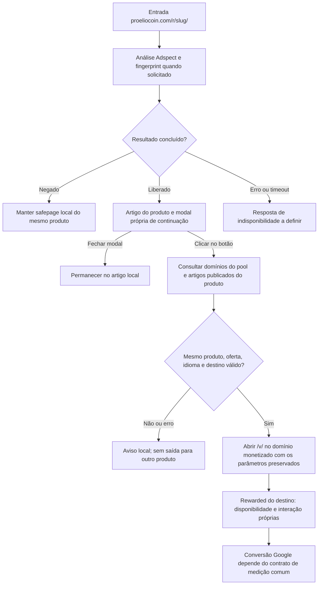

# arb-gate-proeliocoin — plano técnico GDN com modal própria e saída por clique

Atualizado em 22/10/2026. Escopo: implementação e verificação local. A identidade, a integração final da modal e a publicação continuam pendentes.

**Rede confirmada:** Google GDN. Países, clusters, segmentação, orçamento e configuração das ações de conversão pertencem à operação da campanha. A implementação preserva os dados recebidos e distingue os eventos; não escolhe uma ação principal no Google Ads.

**Domínio confirmado pelo usuário:** `proeliocoin.com`. A entrada planejada é `https://proeliocoin.com/r/slug/`. `arb-gate-proeliocoin` permanece como identificador técnico da pasta e do Worker. A escolha do domínio não define o nome visual ou o template e não significa que o B já foi publicado.

**Contrato confirmado pelo usuário:** resultado negado na análise Adspect mantém a safepage local da entrada. Resultado liberado abre uma modal própria de continuação, com interface e textos próprios do projeto. O clique no botão leva ao `/v/` do mesmo produto no site monetizado. Sua entrada mantém a saída por clique; o redirect na entrada foi escolhido para o CheersToSochi.

A modal informa a continuação para o site parceiro. Seu visual e seus textos não devem imitar um anúncio rewarded nem prometer recompensa. O clique de saída independe de exibição de anúncio ou concessão de recompensa. O anúncio rewarded existente continua no destino `/v/`, com eventos próprios. Nome visual, identidade, template e textos da modal em `pt`, `en` e `es` ainda dependem de decisão do usuário.

O [playbook Search/GDN](https://docs.adspect.ai/en/latest/use-cases.html#cloaking-google-search-gdn) descreve página local com botão para destino externo, ação local no ramo liberado e `noop` na safepage com Reverse PHP. O B preserva o formato de navegação; a modal própria é uma escolha do projeto. O perfil atual ainda usa `observe_only: true` e duas ações `noop`, mas o piloto deve aplicar a decisão Adspect conforme o contrato acima. Preservar `enable_fp=true` e o ID existente. Preparar e testar o perfil ativo e o adaptador antes de alterar o stream remoto. Isso não comprova equivalência integral à integração oficial ou aprovação pelo Google.

## Ponto de partida

- [x] Projeto B com stream próprio e fingerprint habilitado.
- [x] Contexto Google GDN e preservação da saída somente após clique.
- [x] Código, assets, dependências e testes próprios; o B não importa a base, o A ou o Clickverso.
- [x] Confirmado o gatilho desejado de navegação: clique no botão da modal.
- [x] Confirmada uma modal própria de continuação, sem apresentação de rewarded.
- [x] Confirmado o tratamento da análise: negado mantém a safepage local; liberado segue para a modal própria e aguarda clique.
- [x] Reutilizar os [12 artigos e slugs selecionados](../arb-gate-cheerstosochi/LANCAMENTO.md#slugs-selecionadas-para-o-próximo-teste), já publicados em domínios participantes do pool: quatro cursos distintos em cada idioma (`pt`, `en` e `es`).
- [x] Domínio do B definido: `proeliocoin.com`, registrado em `site.json`.
- [ ] Definir nome visual, identidade e template do B.

O B ainda não foi publicado. O catálogo próprio contém os 12 registros exatos e suas fixtures. O resolver está ligado ao clique da modal, com testes do Worker e do controlador usando configuração e imagens explicitamente simuladas. O motor isolado foi validado no navegador para fechamento, teclado e foco. Abrir, esperar, fechar e concluir o POST de fingerprint não consultam o pool nem abrem o parceiro. Fechar cancela a operação e impede navegação tardia. A identidade e os textos finais dependem do usuário. As capas dos novos registros ainda precisam ser preparadas; os testes reais de renderização expõem essa falha. O perfil real permanece em observação e sem configuração da modal; o resultado técnico simulado não comprova sua prontidão.

A conferência remota de 22/10 encontrou os IDs e o fingerprint esperados, com `noop` nos dois ramos, mas os dois streams estão em `mode='Review'`. A ativação de `Filter` continua pendente. A auditoria editorial comum encontrou divergências em Alura, Berkeley e Akademus e oferta SPD inconclusiva; disponibilidade HTTP dos 12 destinos não libera elegibilidade editorial.

## Desenho planejado

| Variante planejada | Gatilho de saída | Rewarded antes da saída |
| --- | --- | --- |
| A / CheersToSochi | Após liberação Adspect, redirect HTTP pelo Worker de `/r/` para `/v/` do mesmo produto no pool de domínios. Negado mantém a safepage. Correspondência de destino ainda não comprovada. O A publicado hoje usa botão e observação. | Não integra o desenho solicitado. |
| B | Após liberação Adspect, clique explícito no botão da modal própria. Negado mantém a safepage. Abrir, fechar ou esperar não abre o parceiro. | A modal informa a continuação para o parceiro; o rewarded real está no `/v/`. |

Conteúdo, produto e possibilidade de continuação devem permanecer consistentes para visitantes e revisores. A safepage deve manter conteúdo real do mesmo produto e a oferta acessível; não usá-la como cobertura para ocultar o destino da revisão. Fechar a modal mantém a leitura local.

## 1. Fechar identidade e interface

- [x] B01. Definir o domínio real do B: `proeliocoin.com`.
- [ ] B02. Definir nome, identidade e template a reutilizar.
- [ ] B03. Definir com o usuário o visual e os textos da modal própria em `pt`, `en` e `es`, sem apresentação de anúncio ou promessa de recompensa.
- [ ] B04. Informar no botão que a continuação abre o site parceiro.
- [x] B05. Definir fechamento por botão, Escape e navegação de teclado.
- [x] B06. Definir foco, rótulos acessíveis e retorno ao artigo ao fechar.
- [ ] B07. Definir o estado de espera após o clique e impedir cliques concorrentes naquela operação.
- [ ] B08. Definir o aviso de falha e a opção de tentar novamente.

## 2. Definir produto e destino

- [x] B09. Preparar um catálogo próprio ou outra organização que não altere o A, a base ou o Clickverso.
- [x] B10. Referenciar no B os 12 artigos publicados, com seus domínios, IDs e idiomas. Não criar ou traduzir artigos para o piloto.
- [x] B11. Conferir o contrato de parâmetros recebido para consultar os domínios participantes. País e cluster são valores da campanha; não desenvolver sua escolha no projeto.
- [ ] B12. Revalidar os artigos selecionados e os domínios participantes no contexto recebido para o teste. Se faltar um caso, escolher antes do teste outro curso já publicado nesses domínios.
- [x] B13. Especificar a consulta aos domínios participantes e ao inventário do produto somente após o clique; não limitar a seleção às URLs escolhidas pelo High Offers.
- [x] B14. Especificar a validação de produto, oferta, idioma, publicação, domínio e slug.
- [x] B15. Especificar HTTPS, caminho `/v/`, HTTP 200 e HTML, sem seguir redirects na validação.
- [ ] B16. Preservar os parâmetros GDN e de clique, incluindo os campos necessários à medição por local de exibição, sem aceitar um destino fornecido pelo visitante.
- [ ] B17. Definir falha local quando nenhum candidato corresponder. Não selecionar outro produto.
- [x] B18. Manter análises e erros estruturados, sem diário ou cookie de decisão por visita.

## 3. Fechar a medição comum com o A

O [contrato de medição Google](../adspect/docs/medicao-google.md) registra os achados e as tarefas compartilhadas. O B pode entregar a query correta e ainda perder atribuição no iframe do destino.

- [ ] B19. Medir abertura e fechamento da modal sem tratá-los como conversão Google.
- [ ] B20. Medir o clique de continuação separadamente da chegada ao `/v/`.
- [ ] B21. Distinguir, com o mesmo contrato do A, clique, chegada, exibição do rewarded, recompensa e lead/inscrição. A ação principal e a otimização são configurações da campanha.
- [ ] B22. Confirmar o ID e a label do buyer até a página de destino.
- [ ] B23. Registrar a dependência da correção da captura do clique no responsável pelo template/pixel do destino. A aplicação B não resolve esse problema apenas preservando a query.
- [ ] B24. Não disparar a mesma ação Google na modal e novamente no `/v/`.
- [ ] B25. Conferir valor estimado, moeda e repetição de eventos no percurso observado. A configuração de contagem na conta Google pertence à campanha.
- [x] B26. Registrar que a comparação também muda o fingerprint e a interface; não atribuir toda diferença ao botão.
- [ ] B26a. Especificar transporte e relatórios por local de exibição, campanha, grupo, anúncio, rede e dispositivo, conforme o [contrato técnico GDN](../adspect/docs/medicao-google.md#contrato-técnico-para-gdn).
- [ ] B26b. Conferir, por leitura, o stream remoto e sua associação às campanhas existentes. Planejar a troca do perfil passivo pelo contrato ativo aprovado, preservando ID e fingerprint. Não alterar o fornecedor nesta etapa de planejamento.
- [x] B26c. Registrar os limites do adaptador próprio frente ao contrato documentado. Não presumir equivalência ao Reverse PHP nem criar servidor PHP para reproduzi-lo.

### Roteiro do stream B e da integração

1. Reutilizar `integration.experiments['arb-gate-proeliocoin']` no cadastro central e conferir o mesmo ID em `.dev.vars`. Não usar o ID do A nem criar outro stream.
2. Consultar `GET /streams/{id}` por meio de [experiments/api.js](experiments/api.js) e comparar com `streamSettings(site)` e `verifyStream` de [experiments/stream.js](experiments/stream.js), usando o [site.json do B](site.json). A leitura de 22/10 confirmou somente `mode='Review'` divergente.
3. Conferir o perfil atual: `mode='Filter'`, `enable_fp=true`, `enable_ua=true`, `filter_level=2`, páginas vazias e duas ações `noop`. Preservar essas ações; o Worker aplica `ok` da análise concluída, conforme a [tabela compartilhada](../arb-gate-cheerstosochi/LANCAMENTO.md#42-conferir-o-perfil-atual-e-preparar-o-perfil-ativo). Não exigir a ação `local` usada pelo PHP, colocar o `/v/` do parceiro no stream nem executar código retornado pelo fornecedor.
4. Comparar os valores efetivos com a referência Google Ads e os ajustes aprovados do experimento. Configurar os mesmos campos manualmente equivale a aplicar a predefinição; a ausência de `preset` não exige correção nem prova de uso anterior. Não reaplicar preset nem criar stream por esse motivo. Se um novo stream for autorizado, seguir o [roteiro de criação](../arb-gate-cheerstosochi/LANCAMENTO.md#43-criação-preset-google-ads-e-efeitos-do-setup).
5. Substituir a observação pelo tratamento ativo durante a implementação no próprio B: negado mantém a safepage; liberado entrega artigo e modal própria. Preservar `ADSPECT_ROUTING_ENABLED=false` e `EARLY_LOADER_ENABLED=false` para não reativar caminhos legados. Na futura publicação, usar seu ID no segredo remoto `ADSPECT_STREAM_ID`, com assets e namespace KV próprios.
6. Preservar o desafio de fingerprint no domínio B, o POST local e o cookie `_session_<identificador>` por 60 segundos. O POST pode concluir a análise, mas não representa clique de saída ou conversão. Negação mantém a safepage; após liberação, fechar ou esperar mantém o artigo e somente o clique abre o parceiro.
7. Testar `noop` com `ok=true` e `ok=false`, negação local, liberação para a modal, combinações incoerentes, desafio, POST inválido, erro e timeout do fornecedor. Usar os testes próprios após a independência do B; preparar os casos da modal e do tratamento ativo durante sua implementação. Não modificar a base ou o A para implantar o B.
8. Consultar os relatórios com `bun run report INICIO_ISO FIM_ISO`. Conferir classificação e fingerprint sem tratar essas métricas como confirmação de chegada, fraude ou receita.

`bun run setup` chama o setup próprio do B. Esse comando pode criar um stream se faltar o cadastro e sobrescreve `.dev.vars` após a conferência; ele não é uma consulta somente de leitura. A validação aceita observação ou tratamento ativo; o `mode='Review'` remoto ainda falha contra o perfil esperado `Filter`. O [roteiro técnico compartilhado](../arb-gate-cheerstosochi/LANCAMENTO.md#41-localizar-os-streams-existentes) detalha autenticação, campos, efeitos do setup, vínculo com o Worker, RPC e aceite. Preservar a diferença de fingerprint entre os gates.

## 4. Integração e aceitação

Concluir a interface real após as decisões de identidade e textos. A integração técnica já foi preparada com configuração simulada. Seus testes não substituem o percurso completo do perfil real do B.

- [ ] B27. Implementar a interface e o tratamento ativo definidos nas etapas anteriores: negado mantém a safepage e liberado abre a modal própria com saída por clique.
- [ ] B27a. Testar a safepage real do mesmo produto e a manutenção da oferta acessível, sem tratamento para ocultar o destino de revisores.
- [ ] B28. Confirmar que GET, HEAD, abertura da modal e espera não geram saída automática.
- [ ] B29. Testar fechamento, Escape, foco e leitura sem JavaScript.
- [ ] B30. Testar uma única navegação após clique, preservando os parâmetros aceitos.
- [ ] B30a. Testar o transporte dos campos GDN até o Adspect e o destino, incluindo campos ausentes ou vazios e macros não expandidas.
- [ ] B31. Testar falta de produto, falha do pool, timeout e respostas inválidas.
- [x] B32. Testar rejeição de outro produto, oferta, idioma ou domínio divergente.
- [ ] B33. Testar celular, desktop e textos nos três idiomas; conferir que a modal informa a continuação para o parceiro sem simular rewarded.
- [ ] B34. Testar eventos do destino com rede interceptada, sem anúncios ou conversões reais.
- [ ] B35. Executar os testes pertinentes, bundle e workerd.
- [ ] B36. Atualizar o README e o fluxo atual após a implementação.
- [ ] B37. Preparar a versão candidata, DNS, TLS, assets e bindings próprios antes de publicar.
- [ ] B38. Cumprir as verificações de parâmetros e entrega técnica do [plano A](../arb-gate-cheerstosochi/LANCAMENTO.md#6-conferir-o-contrato-de-parâmetros-gdn), usando a entrada e a saída por clique do B. Não incluir configuração de contas ou campanhas na implementação.
- [ ] B39. Documentar os eventos comprovados e os limites da verificação. A confirmação de atribuição e receita pertence à operação externa da campanha.

Evidência técnica condicional: 42 testes novos cobrem integração do Worker e controlador da modal com UI e imagens simuladas, incluindo fingerprint, negação, clique, fechamento, cancelamento e resposta tardia. O bundle real passou. Na rodada completa, 514 testes passaram e cinco falharam por falta das capas reais. O runtime não usa mais loader ou política de redirect antigos. B27 e o aceite real permanecem pendentes até configurar identidade, textos e imagens e validar esse perfil.

B35 parcial: o workerd passou com UI e imagens simuladas, após compilar o bundle real sem alteração. Foram quatro RPCs, dois POSTs de fingerprint e uma consulta/validação de destino; HEAD não analisou nem navegou. Essa verificação não cobre cancelamento no navegador ou o perfil real incompleto. As cinco falhas reais continuam expostas.

**Concluído quando:** o usuário controla a saída pelo botão, cada saída mantém o mesmo produto e o contrato distingue os eventos e seus responsáveis. A implementação continua pendente; a validação no Google Ads é uma dependência externa.

Os destinos serão definidos e validados antes do teste. Indisponibilidade posterior segue o aviso local já previsto, sem troca de produto. O domínio do B é `proeliocoin.com`; nome visual, identidade, template e textos continuam pendentes de decisão do usuário. A atribuição e as configurações da conta Google ficam na operação da campanha. As evidências técnicas não comprovam aprovação publicitária nem autorizam contornar suspensões.
